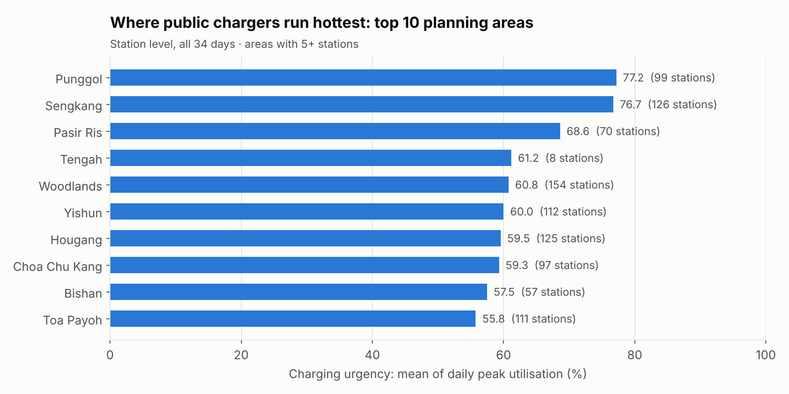
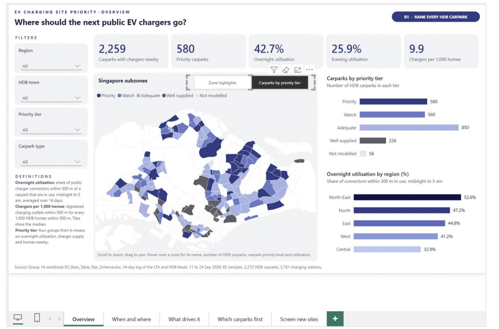
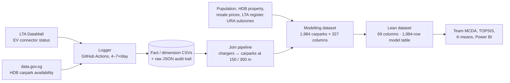

# Singapore EV Charging Grid Predictor

Where should Singapore add public EV chargers, and how many? This project
answers that carpark by carpark, using live charger and carpark data I
collected over 34 days and joined with population, housing and existing
charger supply.

It is the data layer of the **Spatial EV Charging Priority Model**, a team
project (Vector Analytics) for the NUS MTech in Enterprise Business Analytics.
I led data acquisition, governance and dataset creation, and co-led the
Power BI dashboard.



## Results

- **Punggol and Sengkang run hottest.** Across all 34 days, their public
  chargers average a daily peak of 77% utilisation, well ahead of every other
  town. Tengah, a new town with only 8 stations, is already in the top four.
  The carpark-level model in the team submission ranked the same three towns
  first (Punggol 79.9, Sengkang 76.6, Tengah 72.5).
- **Charging is overnight.** Utilisation peaks between midnight and 5 a.m. at
  about 34% and drops to around 20% in the late afternoon, which points to
  residents charging at home carparks rather than daytime visitors.
- **EV use follows car occupancy.** Across the 173 samples the two correlate
  at 0.85 (0.95 on the hourly profile), so a carpark's occupancy pattern is a
  reasonable first guess at EV demand where no charger exists yet.
- **Busy is not the same as broken.** A rule that flags connectors unavailable
  in more than 95% of samples over 14 days, overnight included, stopped dead
  chargers from looking like the most popular ones.


## Dashboard



The team's Power BI dashboard, which I co-led. The Overview page puts every
URA subzone into one of four priority tiers (from K-means on overnight
utilisation, charger supply and nearby homes), and flags 580 HDB carparks as
priority sites. Overnight utilisation is highest in the North-East, at 52.6%.
Other pages cover when and where demand peaks, what drives it, which carparks
come first, and screening of new sites.

## What I built



| Piece | What it does |
|---|---|
| `sg_utilisation_logger.py` | Samples every EV connector (11,400+) and every HDB carpark (2,000+), runs 11 quality checks, stores the result |
| `sg_ev_carpark_pipeline.py` | Matches chargers to carparks, adds six data.gov.sg context layers, writes seven workbooks |
| `.github/workflows/` | Ran collection on GitHub so the small hours were never missed |
| `data/` | The full archive: 173 samples, 1.99 M connector-status rows, 209 raw API snapshots per feed |
| `analysis/make_figures.py` | Rebuilds the charts above from `data/` |

The modelling dataset (168,526 rows × 327 columns, then cut to 69) is
described step by step in [docs/DATASET_CREATION.md](docs/DATASET_CREATION.md).

## Engineering decisions

- **Fact/dimension split.** Writing every connector's full details every hour
  would have been 2 GB a month. Storing only id, status and time hourly, with
  descriptions once a day, cut it to about 70 MB with nothing lost.
- **Raw JSON kept for every sample.** Any CSV, or any new derived column, can
  be rebuilt from source across the full history (`run_local.py --replay`).
- **No API key in code, ever.** The key comes from a GitHub secret or a
  gitignored file, and a pre-commit hook blocks anything key-shaped.
- **Failures are loud and safe.** Atomic file writes, schema-change detection,
  back-off on rate limits, and a run that aborts rather than saving an empty
  sample.

## Tech

Python (pandas, requests, openpyxl, matplotlib), GitHub Actions, REST APIs
(LTA DataMall, data.gov.sg), geospatial joins (haversine, point-in-polygon,
SVY21 → WGS84), Excel, Power BI.

## Repository map

| Path | Contents |
|---|---|
| [docs/MY_CONTRIBUTION.md](docs/MY_CONTRIBUTION.md) | My part of the team project, in detail |
| [docs/DATASET_CREATION.md](docs/DATASET_CREATION.md) | Sources, joins, enrichment, column selection, validation |
| [docs/DATA_COLLECTION.md](docs/DATA_COLLECTION.md) | How the logger and pipeline work, and the edge cases they handle |
| [docs/V2.md](docs/V2.md) | V2: the model rebuilt on the full 34 days (in progress) |
| [docs/GITHUB_SETUP.md](docs/GITHUB_SETUP.md), [docs/SCHEDULING.md](docs/SCHEDULING.md) | Running collection on GitHub or a PC |

## Reproduce

```
pip install -r requirements.txt
python analysis/make_figures.py          # charts, from the archived data
python run_local.py --no-pull --no-fetch # the utilisation workbook, no API calls
```

Collection ran from 11 Sep to 15 Oct 2026 and has ended; the workflows are
disabled. Collecting again needs a free LTA DataMall key: copy
`lta_key.txt.example` to `lta_key.txt` and paste it in.

## Data sources and licence

Contains information from the LTA DataMall EV Charging Points API, the HDB
carpark availability API, HDB Carpark Information, HDB Property Information,
HDB resale flat prices, the Census of Population 2020 and URA Master Plan
subzone boundaries, accessed between September and November 2026 from
datamall.lta.gov.sg and data.gov.sg, which are made available under the terms
of the [Singapore Open Data Licence version 1.0](https://data.gov.sg/open-data-licence).

Code is under the MIT licence (see `LICENSE`).
