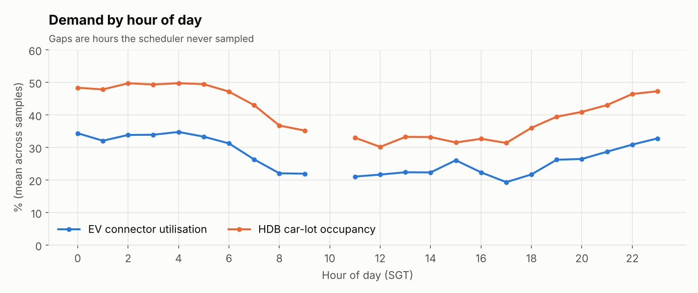
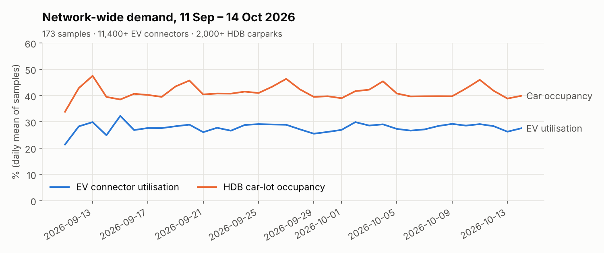
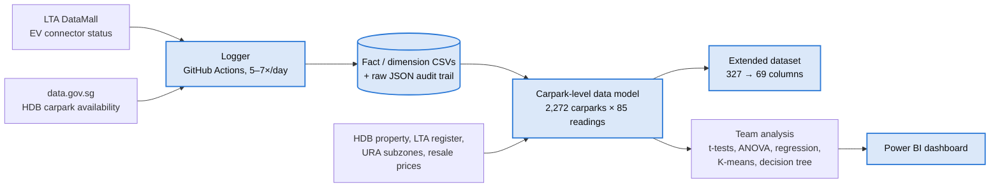

# Singapore EV Charging Grid Predictor

Where should Singapore add public EV chargers? This project ranks every HDB
carpark by how busy the chargers around it are overnight, using live charger
and carpark data logged from the LTA and HDB feeds.

It is the data layer of **Data-Driven Spatial Priority Modelling for Public EV
Charging Infrastructure in Singapore**, a team project (Vector Analytics)
built during the NUS MTech in Enterprise Business Analytics.


*The Power BI dashboard (Overview page), which I co-led. It puts HDB carparks
into four priority tiers from K-means and shows 580 of them as priority
sites. Other pages cover when and where demand peaks, what drives it, which
carparks come first, and screening of new sites.*

## My part

My role in the team project:

| Stage | My role |
|---|---|
| Data acquisition and governance | **Lead** |
| Data understanding, charts and Power BI dashboards | **Co-lead** |
| Problem framing, modelling, shortlisting and write-up | Contributor |

What that meant in practice:

- **Live data logging.** I built the logger and the GitHub Actions schedule
  that polled every LTA charging connector (about 11,400) and every HDB
  carpark's free lots, stamping both feeds with the same time. The project
  analysis used the first 14 days (85 synchronised snapshots); I kept it
  running to 34 days and 173 snapshots.
- **Integration and governance.** I led the stage that turned eight open
  datasets into one carpark-level data model: SVY21 to WGS84 conversion,
  subzone placement by point-in-polygon, station-to-carpark matching,
  distance counts at 300 m and 500 m, profiling, quality checks by dimension,
  and the faulty-station rule. Teammates contributed to each of these.
- **Dataset building.** I added 63 columns to the team workbook and built a
  wider 327-column dataset (1,984 carparks × 85 snapshots) with a lean
  69-column cut for clustering. See [docs/DATASET_CREATION.md](docs/DATASET_CREATION.md).
- **Dashboard.** Co-led the Power BI dashboard above.
- **Engineering.** Storage design, a raw-JSON audit trail, 11 automated
  checks on every sample, and key handling that keeps the API key out of
  the code. See [docs/MY_CONTRIBUTION.md](docs/MY_CONTRIBUTION.md).

## Project findings

From the team analysis of 2,259 HDB carparks with a charger within 300 m:

- **Overnight is the peak.** Chargers near HDB carparks are 42.7% busy
  between midnight and 6 a.m., against 25.9% in the evening (paired t-test,
  p < 0.001), consistent with residents charging near home.
- **Demand is uneven.** Overnight use is 52.6% in the North-East against
  32.9% in Central, and 48.6% at multi-storey carparks against 36.2% at
  surface carparks.
- **The drivers are identifiable.** Newer estates, more 4-room and larger
  flats, and fewer chargers per home go with higher overnight use. With town
  effects, these explain 56% of the variation (R² 0.561; held-out R² 0.57).
- **Four priority tiers.** K-means places 580 carparks in a Priority tier,
  where chargers are 60.5% busy overnight and supply is 8.0 chargers per
  1,000 homes.
- **A rule for new sites.** A depth-3 decision tree picks out Priority
  carparks from carpark features alone with 83% accuracy on unseen carparks,
  against a 74% baseline.
- **Recommendation.** Pilot new chargers at 20 carparks, one per URA
  subzone, before extending to the rest of the Priority tier.

## My extension: all 34 days

The team analysis used 14 days. These charts use everything I logged, rebuilt with
`analysis/make_figures.py`.


Over 34 days, Punggol and Sengkang chargers average a daily peak of 77%,
ahead of every other planning area. The four busiest areas are the same four
towns the team analysis found busiest overnight: Punggol, Sengkang, Tengah and
Pasir Ris.



Network-wide, use holds at about 32–35% from midnight to 5 a.m. and falls to
about 19% at 5 p.m. EV use and HDB car-lot occupancy correlate at 0.85
across the 173 samples.



## How the data flows

Highlighted boxes are the stages I led or co-led.



| Piece | What it does |
|---|---|
| `sg_utilisation_logger.py` | Samples every EV connector and every HDB carpark, runs 11 quality checks, stores the result |
| `sg_ev_carpark_pipeline.py` | Matches chargers to carparks, adds six data.gov.sg context layers, writes seven workbooks |
| `.github/workflows/` | Ran collection on GitHub so the small hours were never missed |
| `data/` | The full archive: 173 samples, 1.99 M connector-status rows, 209 raw API snapshots per feed |
| `analysis/make_figures.py` | Rebuilds the 34-day charts from `data/` |

## Engineering decisions

- **Fact/dimension split.** Writing every connector's full details each
  sample would have been 2 GB a month. Storing only id, status and time per
  sample, with descriptions once a day, cut it to about 70 MB with nothing
  lost.
- **Raw JSON kept for every sample.** Any CSV, or any new derived column, can
  be rebuilt from source across the full history (`run_local.py --replay`).
- **Busy or broken.** The feed cannot tell a broken connector from one in
  use. Stations with no free connector in any reading between 2 and 6 a.m.
  were flagged as suspected faulty, and the 35 carparks near them were left
  out of the model.
- **No API key in code, ever.** The key comes from a GitHub secret or a
  gitignored file, and a pre-commit hook blocks anything key-shaped.
- **Failures are loud and safe.** Atomic file writes, schema-change
  detection, back-off on rate limits, and a run that aborts rather than
  saving an empty sample.

## Tech

Python (pandas, requests, openpyxl, matplotlib), GitHub Actions, REST APIs
(LTA DataMall, data.gov.sg), geospatial joins (haversine, point-in-polygon,
SVY21 → WGS84), Excel data modelling, Power BI. Team analysis: hypothesis
tests, multiple regression, K-means, decision trees.

## Repository map

| Path | Contents |
|---|---|
| [docs/MY_CONTRIBUTION.md](docs/MY_CONTRIBUTION.md) | My part of the project, in detail |
| [docs/DATASET_CREATION.md](docs/DATASET_CREATION.md) | Sources, joins, enrichment, column selection, validation |
| [docs/DATA_COLLECTION.md](docs/DATA_COLLECTION.md) | How the logger and pipeline work, and the edge cases they handle |
| [docs/V2.md](docs/V2.md) | V2: the analysis rerun on all 34 days (in progress) |
| [docs/GITHUB_SETUP.md](docs/GITHUB_SETUP.md), [docs/SCHEDULING.md](docs/SCHEDULING.md) | Running collection on GitHub or a PC |

## Reproduce

```
pip install -r requirements.txt
python analysis/make_figures.py          # charts, from the archived data
python run_local.py --no-pull --no-fetch # the utilisation workbook, no API calls
```

Collection ran from 11 Sep to 15 Oct 2026 and has ended; the workflows are
disabled. Collecting again needs a free LTA DataMall key: copy
`lta_key.txt.example` to `lta_key.txt` and paste it in.

## Data sources and licence

Contains information from the LTA DataMall EV Charging Points API, the HDB
carpark availability API, HDB Carpark Information, HDB Property Information,
HDB resale flat prices, the Census of Population 2020 and URA Master Plan
subzone boundaries, accessed between September and November 2026 from
datamall.lta.gov.sg and data.gov.sg, which are made available under the terms
of the [Singapore Open Data Licence version 1.0](https://data.gov.sg/open-data-licence).

Code is under the MIT licence (see `LICENSE`).
